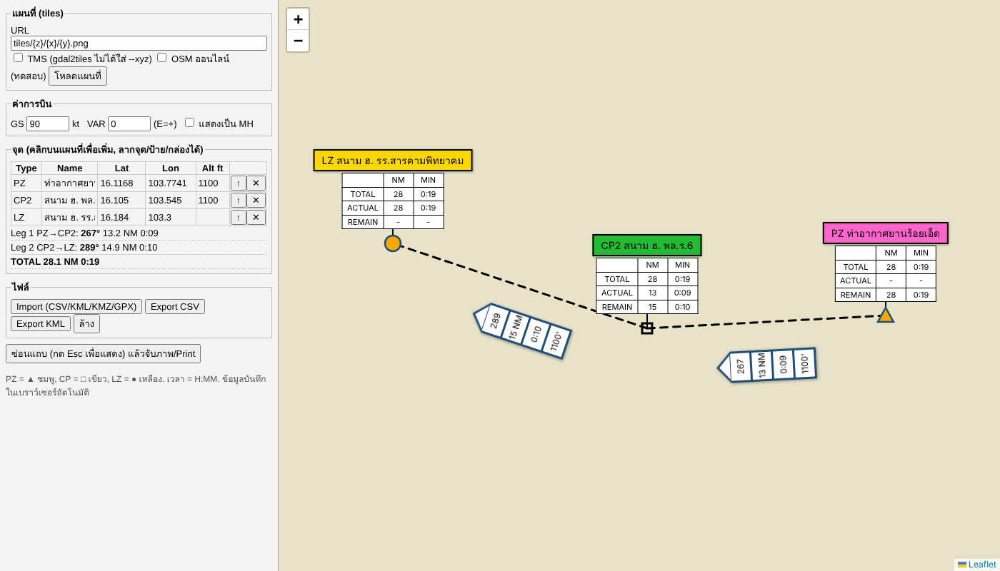

# FalCon2CP – Mission Route Map

เว็บวาดเส้นทางบิน PZ / CP / LZ บนแผนที่ FalconView (CADRG) พร้อมกล่อง HDG / NM / เวลา / ความสูง
และตาราง TOTAL / ACTUAL / REMAIN



## โครงสร้าง
```
index.html      ตัว app (Leaflet)
config.js       ★ ใส่ URL แผนที่ R2 ที่นี่
lib/            leaflet, jszip, pmtiles (offline)
tools/          สคริปต์แปลงแผนที่ / สร้าง KMZ / start.bat (ใช้ในเครื่อง)
docs/ONLINE.md  คู่มือทำแผนที่ + Cloudflare R2
```

## ระบบ
```
GitHub (repo นี้) ──auto deploy──> Cloudflare Pages  (ตัวเว็บ)
Cloudflare R2  map.pmtiles 3 GB  ──> เว็บดึงแผนที่เฉพาะส่วนที่ดู
```

## ตั้งค่าครั้งแรก
1. ทำ `map.pmtiles` แล้วอัปโหลดขึ้น R2 → ดู [docs/ONLINE.md](docs/ONLINE.md)
2. Cloudflare > Workers & Pages > Create > **Pages > Connect to Git** > เลือก repo นี้
   - Framework preset: None, Build command: (เว้นว่าง), Output directory: `/`
3. R2 bucket > Settings > **CORS Policy**:
   ```json
   [{"AllowedOrigins":["https://<ชื่อโปรเจกต์>.pages.dev"],"AllowedMethods":["GET","HEAD"],
     "AllowedHeaders":["range","if-match"],"ExposeHeaders":["etag"],"MaxAgeSeconds":3000}]
   ```
4. แก้ `config.js` ใน GitHub ใส่ URL แผนที่ > Commit → เว็บอัปเดตเองใน ~1 นาที

## ใช้งาน
- คลิกแผนที่ = เพิ่มจุด, ลากจุด / ป้าย / กล่องลูกศรได้
- Import CSV / KML / KMZ / GPX (จาก AirNavFlow), Export CSV / KML
- Export Map: พิมพ์/Save PDF ตามมาตราส่วนจริง (1:50k–1:1M) แบ่งแผ่น A4/A3 ตั้ง/นอน ทับขอบ ≥1 ซม. มีเส้นประแนวต่อแผ่น + เลขแผ่นข้างเคียง + scale bar (ตอน Print ตั้ง Scale 100%)
- ตั้ง GS (kt), VAR, เลือกแสดง MH
- "ซ่อนแถบ" แล้วจับภาพใส่ PPT (Esc = แสดงแถบ)
- เส้นทางเก็บใน browser ของแต่ละเครื่อง ไม่ถูกอัปโหลด
- เปิดแผนที่อื่นชั่วคราว: `?map=https://.../other.pmtiles`
